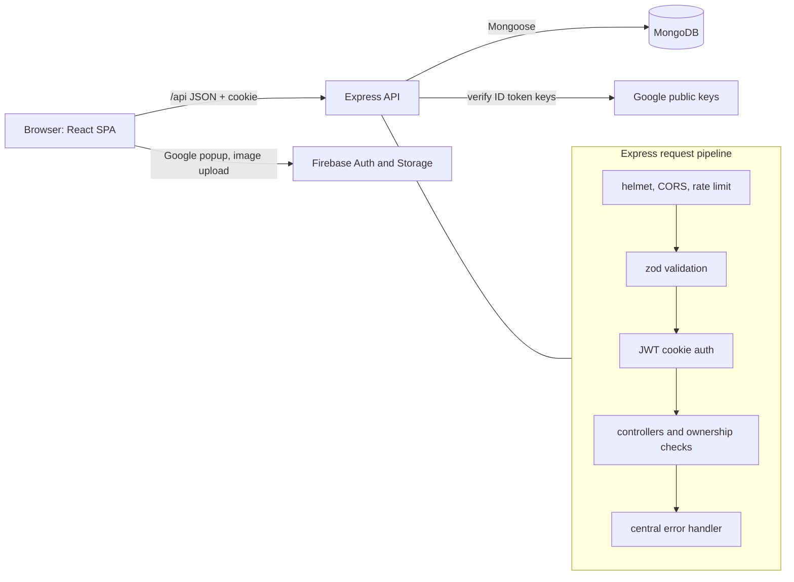

# MERN Real Estate App

[](https://github.com/huss-huss/MERN_Real_State_App/actions/workflows/ci.yml)

A full-stack real-estate listings app: users sign up (email/password or Google), create listings for rent or sale
with photos, and browse them with search, filters, sorting and pagination.

It started as a 2023 learning project. In 2026 the backend was revisited and hardened: request validation,
server-side authorization, verified Google sign-in, security headers, rate limiting, an automated test suite,
Docker and CI. The UI and the product itself are unchanged. See [CHANGELOG.md](CHANGELOG.md).

## Features

- Email/password auth with bcrypt hashing and a JWT kept in an httpOnly cookie
- Google sign-in through Firebase Auth; the API verifies the Firebase ID token itself
- Create, update and delete listings (owner only), up to 6 images uploaded to Firebase Storage
- Search by name, filter by type, offer, parking and furnished, sort by price or date, paginate
- Profile management (username, email, password, avatar) and account deletion
- "Contact landlord" for signed-in users

## Tech stack

| Layer | Tools |
| --- | --- |
| API | Node.js 22, Express 4, Mongoose 7, MongoDB, zod, jsonwebtoken, bcryptjs, helmet, express-rate-limit, jose |
| Client | React 18, Vite, Redux Toolkit + redux-persist, React Router, Tailwind CSS, Swiper |
| Third party | Firebase Auth (Google provider) and Firebase Storage, used from the browser |
| Tooling | Jest, supertest, mongodb-memory-server, ESLint, Docker, GitHub Actions |

## Architecture



In production the API also serves the built client from `client/dist`, so the app runs on a single origin.

```
api/
  app.js            Express app factory (middleware, routes, static client)
  index.js          server bootstrap: env checks, DB connect, graceful shutdown
  config/           env and database
  controllers/      auth, user, listing handlers
  middleware/       validation and rate limiting
  models/           Mongoose schemas
  routes/           route definitions
  services/         Firebase ID token verification
  validators/       zod schemas
  __tests__/        Jest + supertest suites
client/             React + Vite SPA
```

## API

All responses are JSON. Errors have the shape `{ "success": false, "statusCode": 400, "message": "..." }`.
"Auth" means a valid `access_token` cookie; "Owner" means the resource must belong to the signed-in user.

| Method | Path | Access | Description |
| --- | --- | --- | --- |
| GET | `/api/health` | Public | Liveness check |
| POST | `/api/auth/signup` | Public, rate limited | Create account `{ username, email, password }` |
| POST | `/api/auth/signin` | Public, rate limited | Sign in `{ email, password }`, sets cookie |
| POST | `/api/auth/google` | Public, rate limited | Sign in with a Firebase ID token `{ idToken }` |
| GET or POST | `/api/auth/signout` | Public | Clear the session cookie |
| POST | `/api/user/update/:id` | Auth, self | Update username, email, password or avatar |
| DELETE | `/api/user/delete/:id` | Auth, self | Delete account and its listings |
| GET | `/api/user/listings/:id` | Auth, self | List the user's own listings |
| GET | `/api/user/:id` | Auth | Contact card: username, email, avatar |
| POST | `/api/listing/create` | Auth | Create a listing (owner taken from the session) |
| POST | `/api/listing/update/:id` | Auth, owner | Partial update of a listing |
| DELETE | `/api/listing/delete/:id` | Auth, owner | Delete a listing |
| GET | `/api/listing/get/:id` | Public | Get one listing |
| GET | `/api/listing/get` | Public | Search listings (query below) |

Search query parameters: `searchTerm`, `type` (`all`, `rent`, `sale`), `offer`, `parking`, `furnished`
(`true` to filter, otherwise ignored), `sort` (`createdAt`, `regularPrice`), `order` (`asc`, `desc`),
`limit` (1 to 50, default 9), `startIndex` (default 0). Unknown values are rejected with 400.

## Run locally

Requirements: Node.js 20+ and MongoDB (local install or Docker).

```bash
cp .env.example .env                 # set MONGODB_URI, JWT_SECRET, FIREBASE_PROJECT_ID
cp client/.env.example client/.env.local   # set VITE_FIREBASE_API_KEY
npm install
npm install --prefix client

npm run dev           # API on http://localhost:3000 (nodemon)
npm run dev:client    # Vite dev server on http://localhost:5173, proxies /api to the API
```

The Firebase project settings (auth domain, storage bucket) live in `client/src/firebase.js`; point them at your
own Firebase project for image upload and Google sign-in.

### With Docker

```bash
cp .env.example .env    # JWT_SECRET is required; VITE_FIREBASE_API_KEY is passed as a build arg
docker compose up --build
```

This starts MongoDB 7 and the API, which serves the built client on http://localhost:3000.

## Tests and checks

```bash
npm test              # Jest + supertest against an in-memory MongoDB
npm run test:coverage
npm run lint          # ESLint for the API
npm run build --prefix client
```

The suite (70 tests) covers sign-up/sign-in, Google token verification (with locally generated RSA keys),
listing CRUD, search, filtering, sorting, pagination, authentication and ownership failures, rate limiting
and security headers. `mongodb-memory-server` downloads a MongoDB binary on the first run.

CI (`.github/workflows/ci.yml`) runs lint and tests for the API and a production build of the client on every
push and pull request.

## Security notes

- **Validation**: every body, route param and search query is parsed with zod; unknown fields are stripped and
  object/operator payloads are rejected, which blocks NoSQL operator injection. Search terms are regex-escaped.
- **Authorization**: listing ownership comes from the session, never the request body; update and delete check
  ownership on the server and return 403 otherwise.
- **Sessions**: HS256 JWT with a 7-day expiry, stored in an `httpOnly`, `SameSite=Lax` cookie that is `Secure`
  when `NODE_ENV=production`. The token contains only the user id.
- **Google sign-in**: the client sends its Firebase ID token; the API checks signature, issuer, audience and
  `email_verified` against Google's published keys before creating a session.
- **Passwords**: bcrypt hashed, excluded from queries and JSON output. Sign-in uses one generic error message
  for unknown email and wrong password.
- **Headers and limits**: helmet (CSP allowing only the Firebase/Google origins the client needs), CORS
  allowlist via `CORS_ORIGINS`, 100 kB JSON body limit, rate limits on auth routes and the API.
- **Errors**: one error format; stack traces are never returned in production.
- **Config**: secrets come from environment variables only; the server refuses to start without
  `MONGODB_URI` and `JWT_SECRET`, and requires a 32+ character secret in production.

Known limitations: the client still has ESLint findings in older UI code, and the client dependency tree
(Vite 4, Firebase 10) has open `npm audit` advisories that were not addressed in this pass.

## License

ISC
